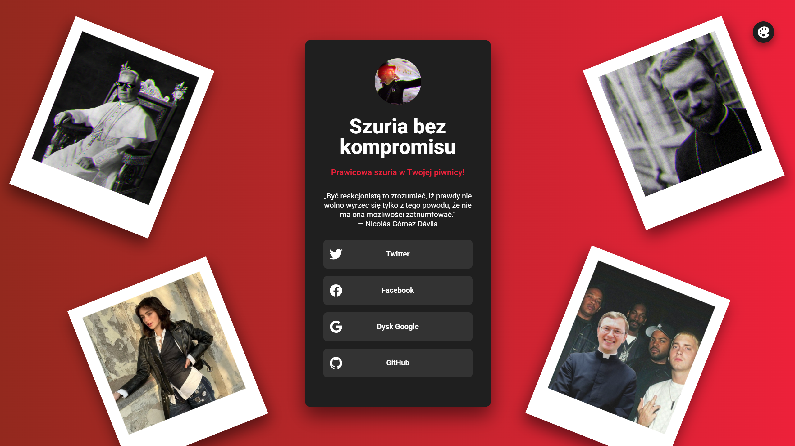
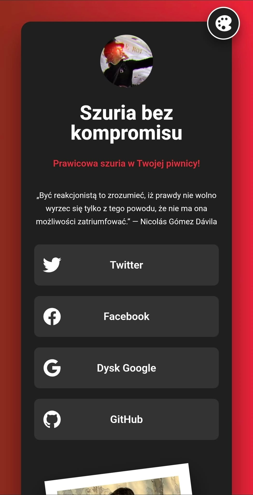

# Link-sharing page

## O projekcie

Niniejsze repozytorium zawiera projekt strony z linkami do mediów społecznościowych inspirowaną aplkiacją Linktree.

Strona jest dostępna pod niniejszym adresem: https://szuria-bez-kompromisu.netlify.app/

## Technologie

Strona została zaprojektowana przy użyciu `HTML5`, `CSS3` i `JavaScript`, bez korzystania z dodatkowych frameworków, czy bibliotek.

## Podgląd

Design strony jest responsywny i dostosowuje się pod urządzenia o różnej rozdzielczości.

